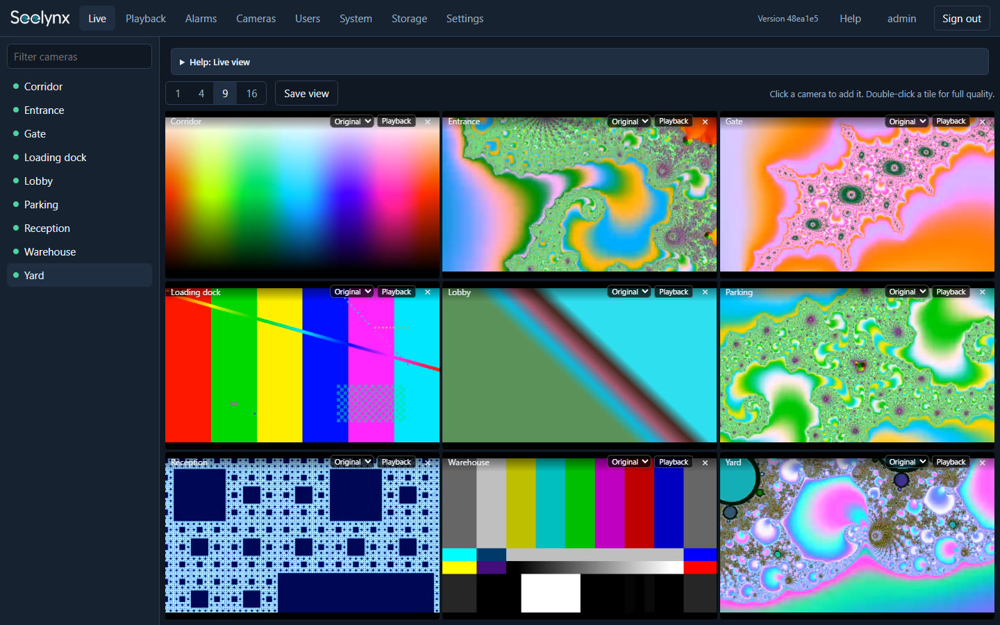
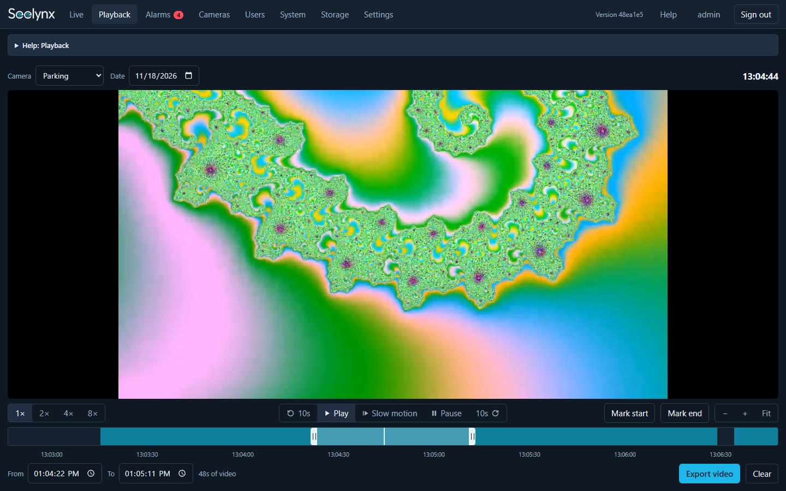
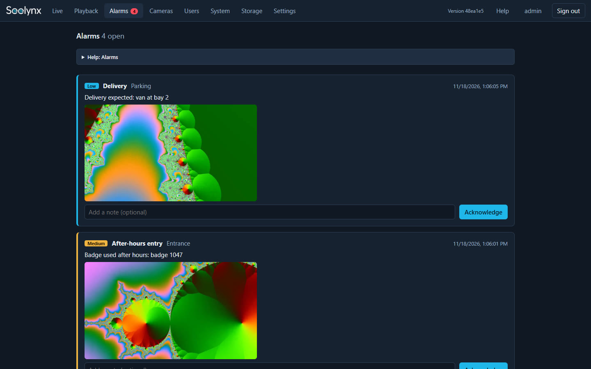
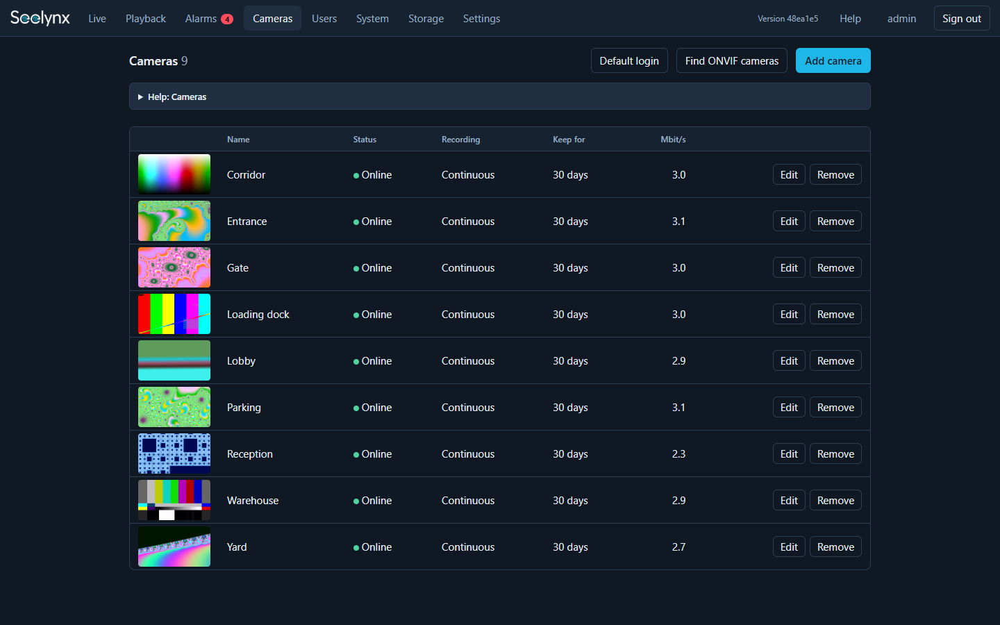

# Seelynx

Open-source video management for IP cameras: live view, continuous recording and
playback from a web browser, on one server. It is designed for up to 100 cameras.

> **Early stage.** Seelynx works, but it hasn't been proven in production yet. Try it, and
> [tell us how it went](https://github.com/drormanor/Seelynx/issues).



<sub>Screenshots show simulated cameras.</sub>

## Why Seelynx

- **Light on hardware.** Video is recorded exactly as the cameras send it, never converted. In
  testing, 64 five-megapixel cameras recording at once used under 4% of the CPU. You need disks,
  not a graphics card.
- **Everything in the browser.** Live view, playback, export and setup all happen in Chrome or
  Edge. Nothing is installed on the viewing computers.
- **Any RTSP or ONVIF camera.** No vendor lock-in. ONVIF cameras can be found automatically, and
  their motion and analytics events can drive rules.
- **Keeps recording when storage fails.** Cameras move to another storage location, such as a
  local disk while a NAS is down, and move back when it returns.
- **Alerts where you already are.** Rules send alarms with a snapshot to email, Teams, Slack,
  Telegram, SMS, MQTT, webhooks and more.
- **One install.** One program with a built-in database. No separate database server to run.

## Quick start

**Windows:** download the latest `seelynx-...-windows-amd64.zip` from
[Releases](https://github.com/drormanor/Seelynx/releases), unzip it, open PowerShell in the folder
and run:

```powershell
.\seelynx.exe -mediamtx .\mediamtx.exe
```

**Linux, with Docker:**

```sh
git clone https://github.com/drormanor/Seelynx.git && cd Seelynx
mkdir -p seelynx-data seelynx-recordings && sudo chown -R 1000:1000 seelynx-data seelynx-recordings
docker compose up -d --build
```

Then open `http://127.0.0.1:8480` (or the server's address, for Docker), create the administrator
account, and add a camera on the **Cameras** page with **Find ONVIF cameras** or **Add camera**.

To keep it running, install it as a [Windows service](docs/WINDOWS-SERVICE.md), or see
[Running in Docker](docs/DOCKER.md) for time zones, HTTPS and network storage. Check the
[requirements](docs/REQUIREMENTS.md) to size the server and disks.

## Screenshots

| | |
|---|---|
|  |  |
| **Playback:** zoomable timeline, slow motion or up to 8× speed, export to MP4 | **Alarms:** priorities, snapshots, notes and acknowledgement |
|  | |
| **Cameras:** status, recording mode, retention and bitrate | |

## What it does today

- Live grid of 1, 4, 9 or 16 cameras over WebRTC, using each camera's sub stream
- Full-quality single-camera view on the main stream
- Continuous recording, with no transcoding
- Playback from a 24-hour timeline, in slow motion or at up to 8× speed
- Add cameras by RTSP URL, or find them with ONVIF
- Default camera login for new cameras, which you can change for any camera
- A picture of each camera on the Cameras page, to tell where it is, and scan results that mark cameras already added
- Fisheye cameras shown as a panorama or a virtual camera you aim by dragging, live and in playback, dewarped in the browser while the recording keeps the whole circle
- Turn the picture of a camera mounted on its side or upside down, for viewing only
- Retention per camera, plus a free-disk-space floor for each storage location
- Several storage locations, such as local disks and a NAS, with cameras spread across them and
  moved automatically when a location stops working, and a location's video can be moved
  to another before it's removed
- Custom roles with per-feature and per-camera access, and password rules
- Motion events from ONVIF cameras, shown on Live, Playback and System
- Rules and alarms, with connections to Slack, Teams, Discord, Telegram, Gmail, Microsoft 365, other email, SMS,
  PagerDuty, Pushover, ntfy, MQTT and webhooks (Zapier, Make, n8n, Home Assistant)
- Playback with a zoomable timeline, and video export to MP4
- Motion-only recording that keeps video from before and after each event
- Camera snapshots on alarms and in alerts
- Built-in driver builder that uses your own AI service to name a camera's analytics
- Private web addresses that let other systems trigger a rule
- Help on every page, with setup steps for each connected service
- System page with camera status, bandwidth, disk use and events

See [docs/ARCHITECTURE.md](docs/ARCHITECTURE.md) for the design, measured capacity
and roadmap.

## Requirements

Seelynx records video without converting it, so it needs little processing power and no
graphics card. Storage and network speed matter most.

| Cameras | CPU | Memory | Network | Disk write speed |
|---|---|---|---|---|
| Up to 10 | 2 cores | 4 GB | 100 Mbit/s | 5 MB/s |
| Up to 25 | 4 cores | 8 GB | 1 Gbit/s | 13 MB/s |
| Up to 50 | 4 cores | 8 GB | 1 Gbit/s | 25 MB/s |
| Up to 100 | 8 cores | 16 GB | 1 Gbit/s, or 10 Gbit/s with network storage | 50 MB/s |

The table assumes 4 Mbit/s per camera. At that rate, each camera needs about 43 GB of storage
a day, or 1.3 TB for 30 days.

- **Operating system:** 64-bit Windows 11, or Linux with Docker. Both are tested. Windows 10
  and Windows Server are expected to work, but haven't been tested.
- **Viewing:** an up-to-date Chrome or Edge on a PC. Nothing is installed on the viewing
  computers.
- **Cameras:** RTSP with H.264 or H.265, ideally with a sub stream. ONVIF is optional.

See [docs/REQUIREMENTS.md](docs/REQUIREMENTS.md) for:
- storage sizing and the kind of disks to use
- network ports and bandwidth
- operating system details
- the measurements behind these figures

## Run it from source (Windows)

You need Node.js 20 or newer. The setup script downloads Go, MediaMTX and ffmpeg
into `.tools\` without changing your system.

```powershell
powershell -ExecutionPolicy Bypass -File scripts\setup-tools.ps1

npm --prefix web install
npm --prefix web run build
.tools\go\bin\go.exe build -o bin\seelynx.exe .\cmd\seelynx

bin\seelynx.exe -mediamtx .tools\mediamtx\mediamtx.exe
```

Open <http://127.0.0.1:8480> and create the administrator account.

By default the server only accepts connections from the same machine. To allow
other machines, use `-listen :8480` together with `-tls-cert` and `-tls-key`, and
open UDP port 8189 for video.

| Option | Default | Purpose |
|---|---|---|
| `-listen` | `127.0.0.1:8480` | Web server address |
| `-data` | `data` | Database and logs |
| `-recordings` | `<data>\recordings` | The first storage location, made on the first start |
| `-min-free-gb` | `50` | Free space the first storage location keeps, by deleting the oldest recordings |
| `-webrtc-udp` | `:8189` | UDP address for live video |
| `-ffmpeg` | next to `seelynx`, then `PATH` | Reads snapshots from recordings. Without it, snapshots come from the camera and can be late |
| `-tls-cert`, `-tls-key` | none | Enable HTTPS |

`-recordings` and `-min-free-gb` only set up the first storage location. After that, add,
change and remove locations on the **Storage** page.

To start Seelynx with Windows and restart it after a crash, see
[Running as a Windows service](docs/WINDOWS-SERVICE.md).

For a Linux server or NAS, including recording to network storage, see
[Running in Docker](docs/DOCKER.md).

## Development

```powershell
.tools\go\bin\go.exe test .\...          # server tests
npm --prefix web run dev                 # client on port 5180, with API proxy
```

Simulate cameras and test at scale:

```powershell
# Terminal 1: fake camera on rtsp://127.0.0.1:18554/main and /sub
powershell -ExecutionPolicy Bypass -File scripts\sim-cameras.ps1

# Terminal 2, with the server running
$env:SL_PASSWORD = '<admin password>'
node web\e2e\smoke.mjs                   # browser test, needs one recording camera
node scripts\load-test.mjs 100 240       # 100 cameras for 4 minutes
node scripts\load-test.mjs --remove      # remove the load-test cameras
```

Tests that change data should run against a separate copy, not a live system:

```powershell
bin\seelynx.exe -data <empty folder> -listen 127.0.0.1:8481 -port-offset 100 -webrtc-udp :8290 -mediamtx .tools\mediamtx\mediamtx.exe
node web\e2e\users.mjs
node web\e2e\integrations.mjs
node web\e2e\drivers.mjs
node web\e2e\playback.mjs
node web\e2e\live.mjs
node web\e2e\cameras.mjs
node web\e2e\storage.mjs
```

## Known limitations

- Camera passwords are encrypted in the database with `data\secret.key`. Keep a copy
  of that file somewhere safe, and restrict access to the `data` folder, because anyone
  with both the database and the key can read the passwords.
- Browsers must support the camera's codec. H.264 is the safe choice; H.265 depends
  on the browser.
- ONVIF has been tested on one Vicon camera only. Other brands are untested.
- Seelynx only moves video between storage locations when you remove a location and choose
  to move its video. When a camera moves to another location, its older video stays where it
  was and is still played back from there.
- There is no installer yet. To run Seelynx as a Windows service, use the script in
  [docs/WINDOWS-SERVICE.md](docs/WINDOWS-SERVICE.md).

## Contributing

Bug reports, camera test results and pull requests are welcome. See
[CONTRIBUTING.md](CONTRIBUTING.md). Contributors sign the [Contributor License Agreement](CLA.md)
once, on their first pull request. Please follow the [code of conduct](CODE_OF_CONDUCT.md).

To report a security problem, see [SECURITY.md](SECURITY.md). Don't open a public issue.

## License

Seelynx is licensed under the GNU Affero General Public License v3.0. See
[LICENSE](LICENSE).

It runs two separate programs, each under its own license:
- [MediaMTX](https://github.com/bluenviron/mediamtx), MIT license
- [ffmpeg](https://ffmpeg.org), LGPL or GPL depending on the build. The setup script downloads a
  GPL build, and the Docker image uses Debian's package.
